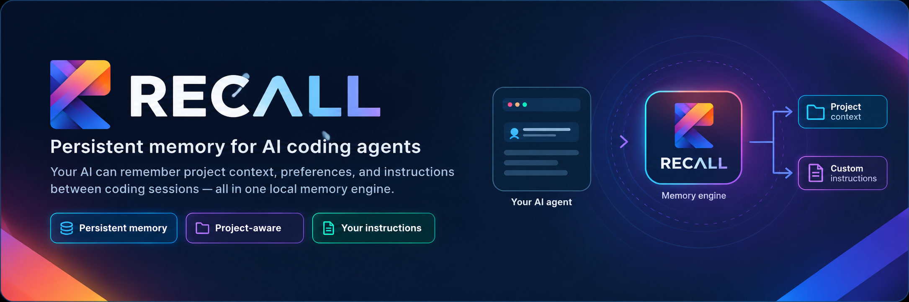
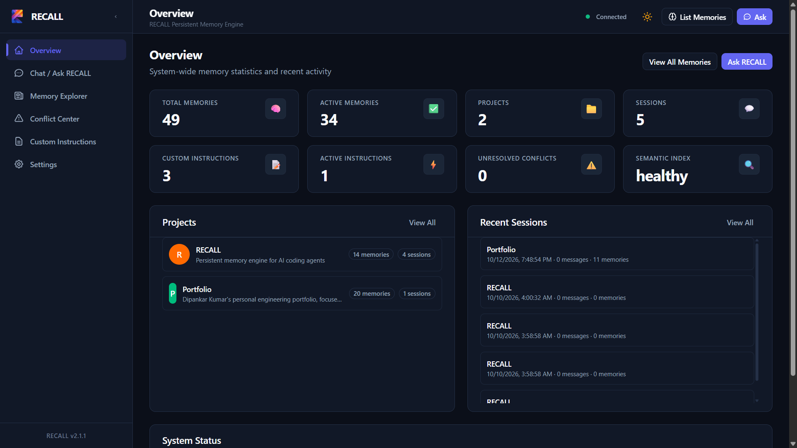
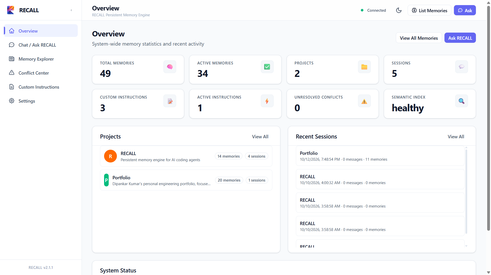

<p align="center">
  
</p>

# RECALL — Persistent Memory Engine for AI Coding Agents

[](docs/RELEASE_PLAN.md)
[](docs/modules/API.md)
[](pyproject.toml)
[](LICENSE)
[](docs/PACKAGING_AND_DISTRIBUTION.md)

> **Persistent project memory, custom instruction enforcement, and deterministic context retrieval for AI coding agents.**

AI coding assistants lose critical context the moment a session ends. Every new conversation forgets past architectural decisions, project conventions, library choices, and user preferences. Repeatedly explaining the same constraints wastes developer time and leads to conflicting suggestions.

**RECALL** solves this by providing a local, persistent cognitive memory layer for AI coding agents. It records key project facts, tracks lineage across sessions, respects explicit user instructions above all else, arbitrates conflicting historical context, and exposes unified context via the **Model Context Protocol (MCP)** and a human-facing **Web Dashboard**.

RECALL is the memory engine itself — not a standalone chatbot or a coding agent. It pairs seamlessly with agent surfaces such as **OpenCode**, **Google Antigravity**, **Cursor**, and **Claude Desktop**.

---

## 💡 What RECALL Does

- **Preserves Long-Term Project Memory:** Captures architectural decisions, conventions, patterns, and facts in an authoritative SQLite ledger (`~/.recall/recall.sqlite3`) that persists across sessions.
- **Enforces User-Authored Custom Instructions:** Gives top-tier authority to explicit developer rules across global and project scopes, preventing agents from drifting from established rules.
- **Retrieves Relevant Context On Demand:** Uses hybrid structured SQL candidate retrieval and fast ChromaDB semantic vector search to fetch relevant memories when an agent prepares a prompt.
- **Resolves Context Conflicts Deterministically:** Detects contradictions between historical memories and arbitrates them using strict authority rules and bounded local arbitration, returning an explicit unresolved state rather than hallucinating certainty.
- **Maintains Memory Lineage & Compaction:** Tracks when newer decisions supersede older ones, ensuring auditability and safe context compaction without losing historical provenance.
- **Optimized for Agent Latency:** Warmed startup (`RECALL_MCP_WARMUP=true`) executes first-query search in ~45 ms (a 93x cold-start speedup) with steady-state warm queries executing in 17–26 ms.

---

## 🔄 How It Works

RECALL coordinates memory capture, storage, and retrieval in a straightforward 5-stage pipeline:

<p align="center">
  
</p>

1. **You work with your AI agent:** Write code and ask questions in your daily tools (OpenCode, Antigravity, Cursor, Claude).
2. **Context is captured:** RECALL captures relevant decisions, instructions, and context through `/recall` commands or MCP tools.
3. **Relevant context is retrieved:** Fast keyword matching and semantic search extract the most relevant project memories.
4. **Conflicts are resolved:** Contradictions are evaluated against authority rules, using a small bounded local LLM when ambiguity remains.
5. **Agent responds with accurate context:** Your agent receives consistent, up-to-date context tailored to your project.

### Architecture Overview

<p align="center">
  
</p>

- **SQLite (Canonical Truth):** Authoritative storage for projects, sessions, memories, lineage, and custom instructions (stored at `%USERPROFILE%\.recall\recall.sqlite3`).
- **ChromaDB (Derived Index):** Derived semantic vector index that can always be completely rebuilt from SQLite.
- **Local LLM (Bounded Arbitration):** Bounded 1B–3B local model for residual conflict arbitration; cannot override user instructions or mutate storage directly.
- **FastMCP Stdio Server & REST API:** Open standards for agent IDE integration and frontend dashboard access.

### Memory Authority Rules

When memories or instructions conflict, RECALL applies strict hierarchical authority:

```text
Explicit user custom instruction (Global / Project)
        ↓
Explicit user update / supersession
        ↓
Current valid canonical memory
        ↓
Older historical memory
        ↓
Local 1B–3B arbitration for residual ambiguity
        ↓
Unresolved / abstain
```

---

## 🖥️ Web Dashboard Preview

RECALL includes a developer cockpit built with React 19 and Tailwind CSS v4. The dashboard allows developers to explore memories, manage custom instructions, audit conflict resolutions, inspect system health, and toggle between Light and Dark themes.

<p align="center">
  
</p>

<p align="center">
  
</p>

---

## 📋 System Requirements

| Component | Minimum Requirement | Recommended |
| :--- | :--- | :--- |
| **Operating System** | Windows 10 (Build 19041+) or Windows 11 (64-bit) | Windows 11 (64-bit) |
| **Python** | Python 3.11 or 3.12 (64-bit, added to `PATH`) | Python 3.12 (64-bit) |
| **User Privileges** | **Standard user account (Administrator privileges NOT required)** | Standard user account |
| **Memory (RAM)** | 4 GB | 8 GB or more |
| **Disk Space** | ~500 MB (includes isolated `.venv` and ~90 MB model weights) | 2 GB free disk space |
| **Node.js (Optional)** | *Not required for runtime.* Only needed if modifying frontend sources. | Node.js 20 LTS (optional) |

---

## 📦 Windows Distribution Installation (Quick Start)

The easiest way to run RECALL on Windows without cloning Git or managing development dependencies is via the pre-packaged distribution bundle.

### Step 1: Download & Extract the Bundle
1. Obtain the distribution archive: `recall-2.1.0-windows.zip`.
2. Extract the ZIP to your chosen folder (e.g. `C:\Users\<username>\RECALL` or `D:\tools\RECALL`).
   *Standard user permissions are sufficient; do not run as Administrator. Avoid folder paths with non-ASCII symbols.*

### Step 2: Run Automated Setup
Open the extracted directory in Windows Explorer or Command Prompt:
- **Batch (Default):** Double-click `setup.bat` (or run `setup.bat` from Command Prompt).
- **PowerShell:** Run `.\setup.ps1`.
  *(If PowerShell blocks execution due to execution policy, run: `powershell -ExecutionPolicy Bypass -File .\setup.ps1`)*

The setup script runs completely in user space and will:
1. Detect and verify that Python 3.11 or 3.12 is on your system `PATH`.
2. Create an isolated virtual environment in `.venv\` inside the extracted folder.
3. Install runtime dependencies (`fastapi`, `uvicorn`, `python-dotenv`, `mcp`, `chromadb`, `sentence-transformers`) with verified fallback linking.
4. Run an initial isolated smoke test in `%TEMP%` to verify database migrations and FastMCP tools without modifying your live user data.
5. Auto-generate `mcp_config.local.json` in the extracted folder with your machine's exact resolved paths.

---

## 🚀 Running RECALL Services

### 1. Web Dashboard & HTTP REST API Server

RECALL supports two distinct modes for running the dashboard and API:

#### Mode A: Packaged Production Mode (Default / End Users)
Double-click `start_api.bat` (or run `.venv\Scripts\python.exe -m api.main`):

```cmd
start_api.bat
```

- **Web Dashboard:** `http://localhost:8080/` (Pre-compiled production assets served directly from FastAPI — zero Node.js/npm required!)
- **Health Liveness Probe:** `http://localhost:8080/health` (or `http://localhost:8080/api/health`, reports `api_version: "1.1.0"`)
- **Interactive Swagger Docs:** `http://localhost:8080/docs`
- **OpenAPI Schema:** `http://localhost:8080/openapi.json`
- **Origin Portability:** Frontend automatically uses same-origin relative API routing in production, supporting custom ports and reverse proxies seamlessly.

#### Mode B: Frontend Development Mode (Contributors / UI Development)
For frontend source development with Hot Module Replacement (HMR):

1. Start the backend API server on port 8080:
   ```cmd
   start_api.bat
   ```
2. In a separate terminal, start the Vite development server:
   ```powershell
   cd frontend
   npm install
   npm run dev
   ```
- **Development Dashboard:** `http://localhost:5173/`
- **Dev Server Proxy:** Vite proxies `/api/*` requests to `http://localhost:8080/*`. Backend CORS middleware also permits direct requests from `http://localhost:5173`.
- **Rebuilding Production Assets:** When frontend changes are complete, build the production bundle with:
  ```powershell
  npm run build
  ```
  This updates `frontend/dist/` which is automatically served by `start_api.bat`.

### 2. Connect Your AI Coding Agent via MCP
RECALL includes a high-performance FastMCP stdio server exposing 8 canonical tools:

| MCP Tool | Purpose |
| :--- | :--- |
| `recall_search` | Search memories across projects with hybrid keyword or semantic matching |
| `recall_get_context` | Assemble active project memories and matching custom instructions |
| `recall_save_memory` | Save a new memory record into canonical SQLite storage |
| `recall_update_context` | Persist an explicit context update taking high precedence |
| `recall_compact` | Summarize older memories above the active cap while preserving lineage |
| `recall_list_custom_instructions` | List custom instructions filtered by scope, project, or status |
| `recall_create_custom_instruction` | Create user instructions (global or project-scoped) |
| `recall_update_custom_instruction` | Update instruction content or toggle active status |
| `recall_delete_custom_instruction` | Deactivate / soft-delete a custom instruction |

**Automatic Configuration (Recommended):**  
During setup, `setup.bat` automatically created `mcp_config.local.json` in the extracted folder with your exact paths. Open that file and copy the ready-to-use JSON block directly into your editor's settings:

- **Google Antigravity:** Paste the `mcpServers` block into `.agents/mcp_config.json` (workspace root or `%USERPROFILE%\.gemini\config\mcp_config.json`).
- **Cursor:** Paste the `mcpServers` block into `.cursor/mcp.json` or `%USERPROFILE%\.cursor\mcp.json`.
- **Claude Desktop:** Paste the `mcpServers` block into `%APPDATA%\Claude\claude_desktop_config.json`.
- **OpenCode:** Paste the `mcp` block into `.opencode/opencode.json` in your workspace root.

---

## 🔌 MCP Client Configuration Examples (Manual)

If configuring manually without `mcp_config.local.json`, use escaped absolute paths pointing to your installation's `.venv`:

### OpenCode
Add to your workspace `.opencode/opencode.json`:

```json
{
  "$schema": "https://opencode.ai/config.json",
  "mcp": {
    "recall": {
      "type": "local",
      "command": ["<PATH_TO_RECALL>\\.venv\\Scripts\\python.exe", "-m", "recall_mcp.server"],
      "environment": {
        "RECALL_MCP_WARMUP": "true"
      },
      "enabled": true
    }
  }
}
```

### Google Antigravity
Add to `.agents/mcp_config.json` in your workspace or global customization root:

```json
{
  "mcpServers": {
    "recall": {
      "command": "<PATH_TO_RECALL>\\.venv\\Scripts\\python.exe",
      "args": ["-m", "recall_mcp.server"],
      "env": {
        "RECALL_MCP_WARMUP": "true"
      }
    }
  }
}
```

### Cursor
Add to `~/.cursor/mcp.json` or `.cursor/mcp.json`:

```json
{
  "mcpServers": {
    "recall": {
      "command": "<PATH_TO_RECALL>\\.venv\\Scripts\\python.exe",
      "args": ["-m", "recall_mcp.server"],
      "env": {
        "RECALL_MCP_WARMUP": "true"
      }
    }
  }
}
```

### Claude Desktop
Add to `%APPDATA%\Claude\claude_desktop_config.json`:

```json
{
  "mcpServers": {
    "recall": {
      "command": "<PATH_TO_RECALL>\\.venv\\Scripts\\python.exe",
      "args": ["-m", "recall_mcp.server"],
      "env": {
        "RECALL_MCP_WARMUP": "true"
      }
    }
  }
}
```

*(Replace `<PATH_TO_RECALL>` with the directory where RECALL was extracted, e.g. `C:\\Users\\username\\RECALL`)*

---

## ⚙️ Configuration & Environment Variables

RECALL comes with sensible defaults and requires zero initial configuration. Customize behavior by copying `.env.example` to `.env` or setting environment variables:

| Variable | Default Value | Category | Purpose |
| :--- | :---: | :---: | :--- |
| `RECALL_MCP_WARMUP` | `true` | **Recommended** | When `true`, warms up embedding models on startup, dropping first-query latency from 4.2s to 45ms. Set to `false` for instant process start. |
| `RECALL_API_HOST` | `0.0.0.0` | Optional | Host address for the HTTP REST API server. |
| `RECALL_API_PORT` | `8080` | Optional | TCP port for the HTTP REST API server. |
| `RECALL_CORS_ORIGINS` | `http://localhost:5173,...` | Optional | Comma-separated list of allowed CORS browser origins. |
| `RECALL_DB_PATH` | *Unset* (`~/.recall/recall.sqlite3`) | Optional | Overrides canonical SQLite database path. |
| `RECALL_EMBEDDING_PROVIDER`| `sentence-transformers` | Optional | Provider for local embeddings (`sentence-transformers`). |
| `RECALL_EMBEDDING_MODEL` | `sentence-transformers/all-MiniLM-L6-v2` | Optional | Hugging Face model identifier for vector search. |
| `RECALL_EMBEDDING_DEVICE`| `cpu` | Optional | Execution device (`cpu` or `cuda`). |
| `RECALL_LOCAL_LLM_MODEL` | `qwen2.5:3b` | Optional | Local Ollama model name for conflict arbitration. |
| `RECALL_LOCAL_LLM_BASE_URL`| `http://localhost:11434` | Optional | Base URL for Ollama local conflict arbitrator. |
| `RECALL_CONFLICT_CLOUD_PROVIDER`| *Unset* | Optional | Opt-in cloud fallback for context overflow (`openai`, `anthropic`, `gemini`). |

---

## 🔒 Data Storage & Privacy Guarantees

All persistent application data is completely isolated from the application installation directory and stored in the user's home profile:

```text
%USERPROFILE%\.recall\
├── recall.sqlite3              # Authoritative canonical database (WAL mode, schema version 2)
├── recall.sqlite3-wal          # Write-Ahead Log sidecar for concurrent reads
├── recall.sqlite3-shm          # Shared-memory index for WAL
├── recall.sqlite3.chromadb/    # Derived ChromaDB persistent vector index
│   ├── chroma.sqlite3          # Collection metadata
│   └── <uuid>/                 # HNSW binary vector indices
└── backups/                    # Non-blocking online SQLite database backups
    └── recall_backup_YYYYMMDD_HHMMSS.sqlite3

%USERPROFILE%\.cache\huggingface\hub\
└── models--sentence-transformers--all-MiniLM-L6-v2\  # Cached model weights (~90 MB)
```

- **100% Local Execution:** Memories, code snippets, and instructions never leave your machine unless an opt-in cloud conflict provider is explicitly configured.
- **Derived State Integrity:** ChromaDB contains only derived index state. If corrupted, it can be regenerated at any time from SQLite via `MemoryManager.rebuild_semantic_index()`.
- **Safe Uninstallation:** Deleting the virtual environment or distribution folder **never** touches your persistent memories in `%USERPROFILE%\.recall\`.

---

## 🌐 SentenceTransformer Model Download & Offline Behavior

1. **Automatic First-Run Download:**
   The default model (`sentence-transformers/all-MiniLM-L6-v2`, ~90 MB) is downloaded automatically on the first semantic search or warmup if internet access is available.
2. **Subsequent Cache-First Loading:**
   Once cached, RECALL loads directly with `local_files_only=True`, bypassing network roundtrips completely.
3. **Air-Gapped / Offline Environments:**
   To deploy on an air-gapped machine without internet access:
   - On an online machine, download the model or copy `%USERPROFILE%\.cache\huggingface\hub\models--sentence-transformers--all-MiniLM-L6-v2`.
   - Place this directory at `%USERPROFILE%\.cache\huggingface\hub\` on the target machine.
   - RECALL will immediately load the cached model offline with zero outbound network calls.
4. **Behavior when Model is Unavailable:**
   If offline and no model cache exists, RECALL returns an actionable error explaining that model files were not found locally. Canonical SQLite memory creation, updates, and structured retrieval continue to function without interruption.

---

## 🛠️ Troubleshooting

### Python is not recognized
- Ensure Python 3.11 or 3.12 (64-bit) is installed from [python.org](https://www.python.org/downloads/).
- Verify that **"Add Python to PATH"** was checked during installation.
- Verify in Command Prompt: `python --version`.

### PowerShell Execution Policy Error
- If running `.\setup.ps1` gives an error that running scripts is disabled:
  ```powershell
  powershell -ExecutionPolicy Bypass -File .\setup.ps1
  ```
  Or run `setup.bat` instead.

### Administrator Privileges
- RECALL does **not** require Administrator privileges. All operations, virtual environments, local databases, and caches are contained strictly in user-writable directories (`.venv\` in the extracted folder, and `%USERPROFILE%\.recall\`).
- Avoid running `setup.bat` or `start_api.bat` as Administrator to prevent file permission discrepancies.

### MCP Stdio Protocol / JSON-RPC Issues
- FastMCP requires `sys.stdout` to remain 100% clean for JSON-RPC framing.
- RECALL automatically redirects all startup warmup output, progress bars, and warnings to `sys.stderr`.
- If an agent reports a communication timeout, ensure your MCP configuration points to the exact `.venv\Scripts\python.exe` path listed in `mcp_config.local.json`.
- To bypass warmup on slower machines, set `RECALL_MCP_WARMUP=false` in the MCP `env` block.

### Port 8080 Conflict
- If port 8080 is used by another application, create a `.env` file with:
  ```ini
  RECALL_API_PORT=8081
  ```
- Or run: `set RECALL_API_PORT=8081 && start_api.bat`.

### Long Path Issues on Windows
- If pip or git reports path length errors, enable long paths in Windows:
  ```powershell
  git config --system core.longpaths true
  ```
  Or enable Win32 Long Paths in the Windows Registry (`LongPathsEnabled = 1`).

---

## 💻 Developer & Contributor Workflow

If you are contributing to RECALL or developing from source:

```bash
# 1. Clone the repository
git clone https://github.com/dp9318/RECALL.git
cd RECALL

# 2. Set up virtual environment
python -m venv .venv
.venv\Scripts\Activate.ps1

# 3. Install in editable mode with all extras
pip install -e ".[mcp,semantic,test]"

# 4. Run full test suite (377+ tests)
pytest -q

# 5. Build frontend production assets
cd frontend
npm install
npm run build

# 6. Build the Windows distribution ZIP bundle
cd ..
python scripts/build_dist_bundle.py
```

---

## 📄 Version & License

- **Application Release:** `v2.1.0`
- **HTTP REST API:** `v1.1.0`
- **Database Schema Version:** `2`
- **License:** MIT License (see [LICENSE](LICENSE))

Detailed architectural specifications and contracts are maintained in [`docs/`](docs/README.md).
